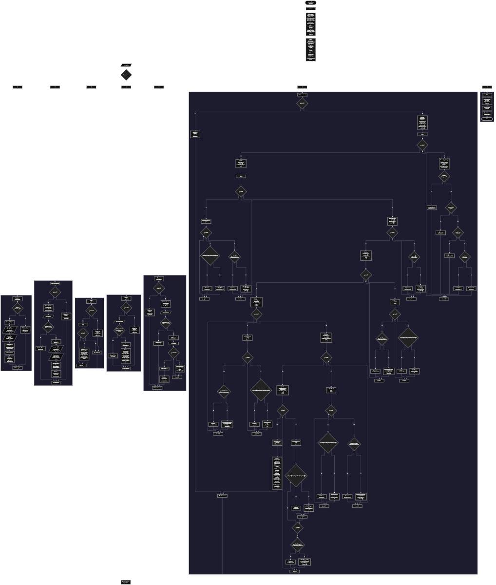

Este proyecto, llamado <b>automovilismo deportivo</b>, fue desarrollado en <b>java</b> como un ejercicio práctico para fortalecer la lógica de programación mediante la creación de un sistema de gestión de competencias automovilísticas desde la consola. El programa cuenta con un menú principal de siete opciones que permite <b>registrar, editar, listar, buscar, eliminar y consultar un resumen estadístico</b> de las competencias registradas. Cada competencia almacena información como el nombre del piloto, vehículo, equipo, competencia, circuito, categoría, cantidad de vueltas, tiempo total, posición final, puntos obtenidos y estado, utilizando arreglos paralelos con una capacidad máxima de <b>10 competencias durante la ejecución</b>. Durante su desarrollo se aplicaron conceptos fundamentales de programación, como variables, arreglos, estructuras condicionales, ciclos repetitivos y estructuras de selección, además de procesos para administrar registros y realizar diferentes análisis estadísticos. Este proyecto permite poner en práctica los conocimientos adquiridos en java y sirve como base para desarrollar sistemas de gestión deportiva más completos utilizando otros lenguajes y tecnologías.

<h2 align="center">⚙️ Funcionamiento del menú principal</h2>

### ➕ Registrar competencia

La opción <b>1) registrar competencia</b> permite almacenar una nueva competencia automovilística. Antes de realizar el registro, el sistema comprueba que la cantidad de competencias almacenadas sea menor que la capacidad del arreglo <b>pilotos.length</b>, utilizando la condición <b>total &gt;= pilotos.length</b> para identificar cuándo no existe espacio disponible. Si se alcanza la capacidad máxima de 10 registros, muestra el mensaje <b>"no hay espacio para registrar mas competencias."</b> e impide continuar con el registro. Si existe espacio disponible, presenta el identificador generado mediante <b>total + 1</b> y solicita el <b>nombre del piloto, vehículo, equipo, competencia, circuito, categoría, cantidad de vueltas, tiempo total, posición final, puntos obtenidos y estado</b>. Los datos se almacenan en la posición correspondiente de sus respectivos arreglos. Finalmente, incrementa la variable <b>total</b> en uno y muestra el mensaje <b>"competencia registrada correctamente."</b>.

### ✏️ Editar competencia

La opción <b>2) editar competencia</b> permite modificar la información de una competencia registrada. Primero, el programa comprueba si existen competencias almacenadas mediante la condición <b>total == 0</b>. Si no hay registros, muestra el mensaje <b>"no existen competencias registradas."</b>. En caso contrario, presenta una lista con el identificador, piloto, vehículo, equipo, competencia, circuito, categoría, vueltas, tiempo, posición, puntos y estado de cada registro. Después, solicita el identificador de la competencia que se desea editar y comprueba que esté dentro del rango permitido mediante la condición <b>idEditar &gt;= 1 &amp;&amp; idEditar &lt;= total</b>. Si la selección es válida, calcula la posición correspondiente mediante <b>idEditar - 1</b> y solicita nuevamente los 11 datos de la competencia, actualizando directamente los valores de los arreglos correspondientes. Finalmente, presenta el mensaje <b>"competencia actualizada correctamente."</b>. Si el identificador seleccionado no corresponde a una competencia registrada, muestra el mensaje <b>"ID no encontrada."</b>.

### 📋 Listar competencias

La opción <b>3) listar competencias</b> permite visualizar todas las competencias registradas actualmente en el sistema. Antes de mostrar la información, el programa comprueba si la variable <b>total</b> es igual a cero. Si no existen registros, presenta el mensaje <b>"no existen competencias registradas."</b>. Si hay competencias disponibles, utiliza un ciclo <b>for</b> controlado por la variable <b>i</b> para recorrer los arreglos desde la primera posición hasta el total de registros almacenados. Durante el recorrido, muestra el identificador, piloto, vehículo, equipo, competencia, circuito, categoría, vueltas, tiempo, posición, puntos y estado de cada competencia. Esta función facilita consultar todos los registros existentes sin necesidad de buscar cada competencia individualmente.

### 🔎 Buscar competencia

La opción <b>4) buscar competencia</b> permite localizar una competencia mediante su identificador. Primero, el programa comprueba si existen competencias registradas. Si no hay registros, muestra el mensaje <b>"no existen competencias registradas."</b>. En caso contrario, solicita el identificador de la competencia que se desea buscar y verifica que esté dentro del rango permitido mediante la condición <b>idBusqueda &gt;= 1 &amp;&amp; idBusqueda &lt;= total</b>. Si el identificador es válido, obtiene la posición correspondiente utilizando <b>idBusqueda - 1</b> y muestra el mensaje <b>"competencia encontrada"</b>, seguido de todos los datos almacenados: piloto, vehículo, equipo, competencia, circuito, categoría, vueltas, tiempo, posición, puntos y estado. Si el identificador introducido no corresponde a ningún registro, presenta el mensaje <b>"ID no encontrada."</b>. La búsqueda se realiza directamente mediante el identificador, sin utilizar un ciclo para recorrer los arreglos.

### 🗑️ Eliminar competencia

La opción <b>5) eliminar competencia</b> permite eliminar una competencia registrada mediante su identificador. Antes de comenzar, el programa comprueba que existan competencias almacenadas. Si no hay registros, muestra el mensaje <b>"no existen competencias registradas."</b>. Si existen competencias disponibles, presenta una lista con los identificadores y todos los datos de cada registro. Después, solicita el identificador de la competencia que se desea eliminar y verifica que esté dentro del rango permitido mediante la condición <b>idEliminar &gt;= 1 &amp;&amp; idEliminar &lt;= total</b>. Si la selección es válida, calcula la posición mediante <b>idEliminar - 1</b> y utiliza un ciclo <b>for</b> controlado por la variable <b>i</b> para desplazar una posición hacia la izquierda los datos de las competencias posteriores en los 11 arreglos: <b>pilotos, vehiculos, equipos, competencias, circuitos, categorias, vueltas, tiempos, posiciones, puntos y estados</b>. Posteriormente, disminuye la variable <b>total</b> en uno y muestra el mensaje <b>"competencia eliminada correctamente."</b>. Si el identificador seleccionado no corresponde a una competencia registrada, presenta el mensaje <b>"ID no encontrada."</b>. El programa no limpia explícitamente la última posición ocupada después del desplazamiento, sino que controla los registros activos mediante la variable <b>total</b>.

### 📊 Mostrar resumen

La opción <b>6) mostrar resumen</b> permite consultar diferentes estadísticas relacionadas con las competencias registradas. Primero, el programa comprueba si existen registros mediante la condición <b>total == 0</b>. Si no hay competencias almacenadas, muestra el mensaje <b>"no existen competencias registradas."</b>. En caso contrario, inicializa variables acumuladoras y contadoras para analizar la información de los arreglos. Mediante un primer ciclo <b>for</b>, calcula el <b>total de vueltas y puntos</b>, identifica al piloto con la mejor posición obtenida y clasifica las competencias según sus estados: <b>programada, en curso, finalizada y cancelada</b>. Para determinar las estadísticas de frecuencia, utiliza ciclos <b>for anidados</b> que comparan los registros y permiten identificar al <b>piloto con más participaciones, equipo más utilizado, vehículo más utilizado, circuito más utilizado y categoría más frecuente</b>. También compara los puntos obtenidos por cada competencia para identificar al piloto con más puntos. Finalmente, calcula el promedio de puntos mediante <b>(double) totalPuntos / total</b> y muestra todas las estadísticas obtenidas. Las comparaciones de nombres utilizan <b>equalsIgnoreCase()</b>, por lo que no distinguen entre mayúsculas y minúsculas. Cuando existen valores empatados en los análisis de frecuencia o en la búsqueda del mayor puntaje y la mejor posición, se conserva el primer valor que alcanza el resultado correspondiente.

### 🚪 Salir del menú principal

La opción <b>7) salir</b> está destinada a finalizar la ejecución del programa y muestra el mensaje <b>"gracias por utilizar Automovilismo Deportivo."</b>. El menú principal se encuentra dentro de una estructura repetitiva <b>do-while</b>, que mantiene el programa en funcionamiento mientras el usuario selecciona las diferentes operaciones disponibles. Cuando la variable <b>opcion</b> toma el valor <b>7</b>, la condición <b>opcion != 7</b> deja de cumplirse y finaliza el ciclo. Finalmente, el programa cierra el objeto <b>Scanner</b> mediante la instrucción <b>entrada.close()</b>.

<h2 align="center">🧠 Temas aplicados en el proyecto</h2>

### 📦 Variables

En este proyecto se utilizan variables para controlar la cantidad de competencias registradas, almacenar la opción seleccionada en el menú, recorrer los arreglos, identificar las posiciones de los registros que se desean editar, buscar o eliminar y realizar diferentes cálculos estadísticos. También se utilizan variables acumuladoras, contadoras y auxiliares para determinar las estadísticas de participación, puntos, posiciones, equipos, vehículos, circuitos, categorías y estados de las competencias. Cada variable cumple una función específica dentro de las operaciones de gestión y análisis de información.

🔢 **Opcion:** Almacena la opción seleccionada por el usuario en el menú principal.

📊 **Total:** Almacena la cantidad actual de competencias registradas.

🔄 **I:** Funciona como contador en los ciclos y permite recorrer los arreglos, mostrar registros y desplazar datos durante la eliminación.

🔁 **J:** Controla el recorrido interno de los ciclos anidados utilizados para calcular las frecuencias de pilotos, equipos, vehículos, circuitos y categorías.

🆔 **IdEditar:** Almacena el identificador de la competencia que se desea modificar.

🔎 **IdBusqueda:** Almacena el identificador de la competencia que se desea buscar.

🗑️ **IdEliminar:** Almacena el identificador de la competencia que se desea eliminar.

📍 **Posicion:** Almacena el índice correspondiente al identificador seleccionado mediante la operación de resta de uno.

➕ **TotalVueltas:** Acumula la cantidad de vueltas de todas las competencias registradas.

🏆 **TotalPuntos:** Acumula los puntos obtenidos en todas las competencias.

📈 **PromedioPuntos:** Almacena el promedio de puntos calculado a partir del total de puntos y la cantidad de competencias registradas.

🥇 **MejorPosicion:** Almacena la mejor posición obtenida entre las competencias registradas.

👤 **PilotoMejorPosicion:** Almacena el nombre del piloto que obtuvo la mejor posición.

🏎️ **PilotoMayor:** Almacena el piloto con mayor cantidad de participaciones.

⭐ **PilotoMasPuntos:** Almacena el piloto que obtuvo la mayor cantidad de puntos en una competencia.

📊 **MayorPuntos:** Almacena la mayor cantidad de puntos obtenida en un registro.

👥 **CantidadPilotoMayor:** Almacena la mayor frecuencia de participaciones de un piloto.

🏁 **EquipoMayor:** Almacena el equipo que aparece con mayor frecuencia en los registros.

🚗 **VehiculoMayor:** Almacena el vehículo que aparece con mayor frecuencia en los registros.

🏟️ **CircuitoMayor:** Almacena el circuito que aparece con mayor frecuencia en los registros.

🏅 **CategoriaMayor:** Almacena la categoría que aparece con mayor frecuencia en los registros.

🔢 **CantidadEquipoMayor, CantidadVehiculoMayor, CantidadCircuitoMayor y CantidadCategoriaMayor:** Almacenan las frecuencias máximas encontradas para cada uno de estos elementos.

🔄 **CantidadPiloto, CantidadEquipo, CantidadVehiculo, CantidadCircuito y CantidadCategoria:** Funcionan como contadores auxiliares para calcular las coincidencias durante los análisis de frecuencia.

📋 **Programadas, EnCurso, Finalizadas y Canceladas:** Almacenan la cantidad de competencias clasificadas según cada uno de los estados reconocidos por el programa.

### 🗃️ Arreglos

En este proyecto se utilizan once arreglos relacionados con la información de cada competencia automovilística. Cada arreglo tiene una capacidad de <b>10 posiciones</b> y utiliza el mismo índice para representar los datos correspondientes a un mismo registro. Por ejemplo, la información de una competencia almacenada en la posición <b>0</b> se encuentra distribuida entre <b>pilotos[0], vehiculos[0], equipos[0], competencias[0], circuitos[0], categorias[0], vueltas[0], tiempos[0], posiciones[0], puntos[0] y estados[0]</b>. Esta organización permite registrar, consultar, modificar, eliminar y analizar las competencias de manera ordenada.

👤 **Pilotos[10]:** Almacena los nombres de los pilotos participantes.

🚗 **Vehiculos[10]:** Almacena los vehículos utilizados en las competencias.

🏎️ **Equipos[10]:** Almacena los nombres de los equipos participantes.

🏁 **Competencias[10]:** Almacena los nombres de las competencias automovilísticas.

🏟️ **Circuitos[10]:** Almacena los nombres de los circuitos donde se realizan las competencias.

🏆 **Categorias[10]:** Almacena las categorías correspondientes a cada competencia.

🔢 **Vueltas[10]:** Almacena la cantidad de vueltas realizadas en cada competencia.

⏱️ **Tiempos[10]:** Almacena el tiempo total registrado en cada competencia.

🥇 **Posiciones[10]:** Almacena la posición final obtenida por cada piloto.

⭐ **Puntos[10]:** Almacena los puntos obtenidos en cada competencia.

📋 **Estados[10]:** Almacena el estado correspondiente a cada competencia.

### 🔀 Estructuras condicionales

En este proyecto se utilizan las estructuras <b>if, else if y else</b> para comprobar si existe espacio disponible antes de registrar una competencia, verificar si hay registros antes de realizar determinadas operaciones, validar los identificadores seleccionados para editar, buscar o eliminar una competencia y determinar si se debe actualizar un resultado estadístico. También se utilizan condiciones para comparar las vueltas, puntos, posiciones y frecuencias de los registros. Además, se emplea <b>equalsIgnoreCase()</b> para identificar los estados de las competencias y comparar los nombres de pilotos, equipos, vehículos, circuitos y categorías sin distinguir entre mayúsculas y minúsculas. Estas condiciones permiten que el programa responda de manera diferente según la información almacenada y el resultado de cada operación.

### 🔄 Estructuras repetitivas

En este proyecto se utilizan los ciclos <b>do-while</b> y <b>for</b>. El ciclo <b>do-while</b> mantiene activo el menú principal y permite ejecutar diferentes operaciones hasta que el usuario selecciona la opción 7. Los ciclos <b>for</b> permiten recorrer los arreglos para mostrar las competencias registradas, consultar los datos y realizar los cálculos estadísticos. Durante la eliminación, también se utiliza un ciclo <b>for</b> para desplazar los datos de las competencias posteriores una posición hacia la izquierda. Por otro lado, los ciclos <b>for anidados</b> permiten comparar los registros entre sí y calcular la frecuencia de pilotos, equipos, vehículos, circuitos y categorías.

### 🎯 Estructura switch

El programa evalúa el valor almacenado en la variable <b>opcion</b> y ejecuta el bloque de instrucciones correspondiente mediante la estructura <b>switch</b>. Cada caso representa una operación específica del sistema: <b>registrar competencia, editar competencia, listar competencias, buscar competencia, eliminar competencia, mostrar resumen o salir</b>. También se utiliza el bloque <b>default</b> para mostrar el mensaje <b>"opcion no valida."</b> cuando el usuario introduce un número que no corresponde a ninguna de las opciones definidas en el menú.

### 🔢 Dimensionamiento de arreglos

El programa utiliza la declaración de arreglos con la instrucción <b>new</b> para establecer la capacidad de los espacios destinados a almacenar la información de las competencias. Se definieron <b>10 posiciones</b> para cada uno de los once arreglos, lo que permite administrar hasta 10 competencias durante la ejecución. La cantidad de posiciones ocupadas se controla mediante la variable <b>total</b>, mientras que la capacidad disponible se comprueba utilizando <b>pilotos.length</b>. De esta manera, las operaciones recorren únicamente los registros comprendidos entre la primera posición y el total actual de competencias.

### 🔄 Reorganización de registros

Cuando se selecciona una competencia para eliminarla, el programa utiliza un ciclo <b>for</b> que comienza en la posición seleccionada y continúa mientras <b>i &lt; total - 1</b>. En cada repetición, los datos de la posición siguiente se copian sobre la posición actual en los once arreglos: <b>pilotos, vehiculos, equipos, competencias, circuitos, categorias, vueltas, tiempos, posiciones, puntos y estados</b>. Después de completar el desplazamiento, la variable <b>total</b> disminuye en uno. De esta manera, los registros posteriores ocupan las posiciones disponibles y el programa mantiene el control de las competencias activas sin necesidad de crear nuevos arreglos. La última posición no se limpia explícitamente, ya que las operaciones utilizan la variable <b>total</b> para determinar cuántos registros están activos.

<h2 align="center">¿Cómo se implementaron las operaciones crud en el proyecto?</h2>

Las operaciones <b>crud</b> se implementaron mediante las opciones del menú principal, permitiendo administrar las competencias automovilísticas registradas. La operación <b>crear</b> corresponde a <b>registrar competencia</b>, donde se introducen los once datos de un nuevo registro; <b>leer</b> se realiza mediante las opciones <b>buscar competencia, listar competencias y mostrar resumen</b>, que permiten consultar la información almacenada y sus estadísticas; <b>actualizar</b> corresponde a <b>editar competencia</b>, donde se modifican los datos de una competencia registrada; y <b>eliminar</b> se realiza mediante la opción <b>eliminar competencia</b>, que desplaza los registros posteriores para reorganizar los arreglos. Estas operaciones utilizan variables, arreglos, condicionales y ciclos para gestionar la información almacenada temporalmente durante la ejecución del programa.

<h2 align="center">Diagrama de flujo del proyecto</h2>

<h2 align="center">🛡️ Validaciones del programa</h2>

### 📭 No existen competencias registradas

Esta validación se utiliza en las opciones de <b>editar, listar, buscar, eliminar y mostrar resumen</b>. El programa comprueba si la variable <b>total</b> es igual a <b>0</b> y, si no existen competencias registradas, muestra el mensaje <b>"no existen competencias registradas."</b>. Esta comprobación evita continuar con las operaciones que necesitan información almacenada cuando todavía no existen registros.

### ⚠️ Capacidad máxima de competencias

Esta validación se utiliza durante el registro de nuevas competencias para controlar la capacidad máxima de los arreglos. El programa comprueba si <b>total &gt;= pilotos.length</b> antes de permitir agregar un nuevo registro. Si existe espacio disponible, solicita los datos de la competencia y aumenta la variable <b>total</b> en uno. En caso contrario, muestra el mensaje <b>"no hay espacio para registrar mas competencias."</b>, impidiendo registrar más competencias cuando se alcanza el límite de 10 posiciones.

### 🔢 Identificador de competencia

Esta validación se utiliza durante las operaciones de <b>editar, buscar y eliminar</b>. El programa comprueba que el identificador introducido sea mayor o igual a <b>1</b> y menor o igual al valor de <b>total</b>. Si el identificador está dentro del rango permitido, calcula la posición correspondiente restando uno al número introducido. Si el identificador no corresponde a una competencia registrada, muestra el mensaje <b>"ID no encontrada."</b>. Esta comprobación evita acceder a posiciones que no corresponden a los registros activos.

### 📋 Clasificación de estados

Esta comprobación se utiliza durante la generación del resumen estadístico. El programa compara el contenido del arreglo <b>estados</b> mediante el método <b>equalsIgnoreCase()</b> para identificar las competencias que se encuentran en los estados <b>"Programada", "En curso", "Finalizada" y "Cancelada"</b>. Cada coincidencia incrementa el contador correspondiente. Los estados diferentes de estos cuatro valores no incrementan ninguno de los contadores establecidos.

### ⚠️ Opción inválida

La estructura <b>switch</b> incluye el bloque <b>default</b>, que muestra el mensaje <b>"opcion no valida."</b> cuando el usuario introduce un número que no corresponde a ninguna de las siete opciones definidas en el menú principal. Esta comprobación permite informar al usuario cuando selecciona una opción que no está disponible.

<h2 align="center">🎯 Objetivo del proyecto</h2>

El objetivo principal de este proyecto es fortalecer la <b>lógica de programación</b> mediante el desarrollo de un sistema de gestión de competencias automovilísticas en <b>java</b>. A través de su construcción se busca aplicar los conocimientos adquiridos sobre variables, arreglos, estructuras condicionales, ciclos repetitivos y estructuras de selección, integrándolos para resolver un problema de manera organizada. Además, el proyecto permite comprender cómo registrar, consultar, modificar y eliminar información, así como realizar análisis estadísticos mediante acumuladores, contadores y ciclos anidados. De esta manera, se establece una base para desarrollar sistemas de gestión deportiva más completos utilizando otros lenguajes y tecnologías.

